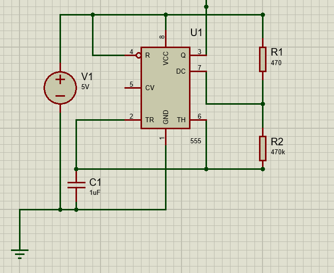
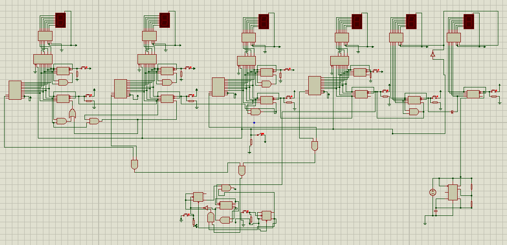

# Digital-Clock-With-Alarm-Functions-using-Decade-counters
"A digital clock with alarm functionality implemented using discrete logic gates, counters (74HC390), JK FLIP FLOPS, and comparators (74HC85) without microcontrollers."
# Digital Clock Integrated with Alarm (System Level Implementation)

## 📄 Abstract
This project demonstrates the design and hardware implementation of a Digital Clock with Alarm functionality built entirely using fundamental digital integrated circuits (ICs). Unlike modern solutions that use microcontrollers (like Arduino), this project utilizes sequential and combinational logic design principles to achieve timekeeping and alarm features.

## ⚙️ Key Features
* **Precision Timing:** Uses an NE555 Timer in astable mode for accurate clock pulse generation.
* **Cascaded Counting:** Implements specific counting logic using 74HC390 Dual Decade Counters for Seconds, Minutes, and Hours.
* **Alarm System:** Features a comparator-based trigger (74HC85) that activates a buzzer when the current time matches the set alarm time.
* **Display Multiplexing:** Utilizes 74HC157 Multiplexers to toggle the 7-segment displays between "Real Time" and "Alarm Set" modes.
* **Manual Mode Switching:** Users can toggle between clock display and alarm display via a MUX selection line.

## 🛠️ Components List
| Component | Specification | Quantity | Function |
| :--- | :--- | :--- | :--- |
| **IC 74HC390** | Dual Decade Counter | 6 | Counting Seconds, Mins, Hours |
| **IC CD4543** | BCD-to-7 Segment | 6 | Driving the displays |
| **IC 74HC157** | Quad 2-to-1 MUX | 4 | Switching between Clock/Alarm view |
| **IC 74HC85** | 4-bit Comparator | 4 | Comparing Clock vs Alarm time |
| **NE555** | Timer IC | 1 | Generating the 1Hz Clock signal |
| **Displays** | 7-Segment LED | 6 | Visual Output |
| **Push Buttons**| Tactile Switches | 24 | Time setting, Alarm setting |
| **Misc** | Resistors, Caps, PCB | - | Circuit stability & Pull-down logic |

## 🔌 Circuit Diagrams
### 1. 555 Timer Astable Multivibrator

*The clock pulse generator tuned to approximately 1Hz.*

### 2. Main Logic Circuit

*Integration of Counters, Decoders, and Multiplexers.*

## 📸 Hardware Implementation

*The final assembled circuit on PCB.*

## 🧠 Logic & Theory
1.  **Clock Generation:** The NE555 generates a square wave. This is fed into the first 74HC390 counter.
2.  **Counting:** The counters are cascaded. The "Seconds" unit triggers the "Minutes" unit every 60 counts, which in turn triggers the "Hours" unit.
3.  **Alarm Logic:** The current BCD value of the clock is continuously compared with the user-set BCD value of the alarm using the 74HC85 Magnitude Comparator. When `A = B`, the buzzer activates.

## 🔮 Future Improvements
* **Snooze Function:** Implementing a temporary silence feature for the alarm already integrated.
* **AM/PM Indication:** Adding logic to distinguish morning and evening hours.
* **Countdown Timer:** Extending functionality to include a countdown mode.

## 📄 License
This project is open for educational use.
